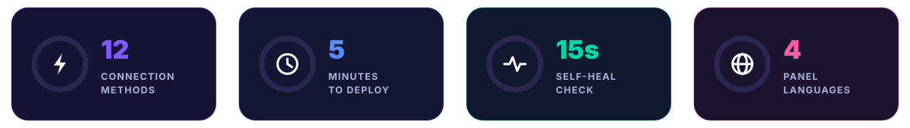

<div align="center">


# ⚡ جینکس | 𝗝𝗶𝗻𝗫

### پنل مرزبان روی Railway · بدون سرور · بدون دردسر · کاملاً رایگان

<a href="https://t.me/Super_Jinx"></a>
<a href="https://github.com/x4gpanell"></a>


<br/><br/>



[**🚀 نصب**](#-نصب-در-۵-دقیقه) ·
[**💎 ویژگی‌ها**](#-چرا-سوپر-جینکس) ·
[**🧩 معماری**](#-چطور-کار-می-کنه) ·
[**⚡ کانفیگ‌ها**](#-۱۲-روش-اتصال) ·
[**🤝 نمایندگی**](#-پنل-نمایندگی) ·
[**🛠 عیب‌یابی**](#-عیب-یابی) ·
[**🇬🇧 English**](#-english)

</div>

<p align="center"></p>

## 💎 چرا سوپر جینکس؟

<table>
<tr>
<td width="33%" valign="top" align="center">

<h3>🚀 نصب یک‌کلیکی</h3>

Fork کن، به Railway وصل کن، تموم.
با **`admin / admin`** وارد شو.
بدون VPS، بدون دامنه، بدون سرتیفیکیت.

</td>
<td width="33%" valign="top" align="center">

<h3>⚡ ۱۲ روش اتصال</h3>

هر روش یه ترکیب جدا از پروتکل، اثر انگشت TLS و فرگمنت.
اپراتور هر کدوم رو ببنده، بقیه وصلن.

</td>
<td width="33%" valign="top" align="center">

<h3>🩺 خودترمیم</h3>

ربات داخلی هر ۱۵ ثانیه همه‌چی رو چک می‌کنه و خرابی رو خودش درست می‌کنه.
بکاپ روزانه هم داره.

</td>
</tr>
<tr>
<td valign="top" align="center">

<h3>🤝 پنل نمایندگی</h3>

ساخت نماینده با ویزارد، پکیج آماده، سقف کاربر، حجم و تاریخ.
همه‌ی محدودیت‌ها سمت سرور.

</td>
<td valign="top" align="center">

<h3>🎫 صفحه‌ی ساب JinX Pass</h3>

صفحه‌ی اختصاصی برای کامپیوتر و موبایل با پینگ زنده، QR، کپی مطمئن و ربات پشتیبان.

</td>
<td valign="top" align="center">

<h3>🔒 ضد دستکاری</h3>

اینباند اصلی قفله و هر تغییری ظرف ۲۰ ثانیه خودش برمی‌گرده.
۱۰ رمز اشتباه = قفل ورود.

</td>
</tr>
<tr>
<td valign="top" align="center">

<h3>🌐 ۴ زبان</h3>

فارسی · English · Русский · 中文
عوض کردن زبان بدون رفرش.

</td>
<td valign="top" align="center">

<h3>🚫 ضد تبلیغ</h3>

تبلیغات و ردیاب‌های سایت‌ها و اپ‌ها روی خود سرور بسته میشن.

</td>
<td valign="top" align="center">

<h3>📱 پنل موبایل‌فرندلی</h3>

فونت وزیرمتن داخل ایمیج، راست‌چین درست، دکمه‌ها اندازه‌ی انگشت.

</td>
</tr>
</table>

<p align="center"></p>

## 🚀 نصب در ۵ دقیقه


> [!TIP]
> هیچ چیزی رو لازم نیست دستی تنظیم کنی. فقط این قدم‌ها رو به ترتیب برو.

| قدم | کار |
|:--:|---|
| **۱** | بالای همین صفحه **⭐ Star** و بعد **🍴 Fork** رو بزن |
| **۲** | توی [Railway](https://railway.com) برو `New Project` ← `Deploy from GitHub repo` و ریپوی خودت رو انتخاب کن |
| **۳** | `Settings` ← `Region` ← **🇳🇱 EU West (Amsterdam)** (کمترین پینگ از ایران) |
| **۴** | روی سرویس راست‌کلیک ← `Attach Volume` و مسیر رو بذار **`/var/lib/marzban`** |
| **۵** | `Settings` ← `Networking` ← `Generate Domain` و پورت رو بذار **`8080`** |
| **۶** | مطمئن شو **Serverless / App Sleeping خاموشه** |
| **۷** | **Redeploy** 🎉 |

<div align="center">

| 🌐 آدرس پنل | 👤 یوزر | 🔑 رمز اولیه |
|:--:|:--:|:--:|
| `https://xxxx.up.railway.app/dashboard/` | `admin` | `admin` |

</div>

> [!IMPORTANT]
> بعد از اولین ورود از منوی **☰** گزینه‌ی **تغییر نام کاربری و رمز عبور** رو بزن و رمز رو عوض کن.

<p align="center"></p>

## 🧩 چطور کار می کنه


همه‌چی روی یه پورت (**8080**) جمع شده: Railway روی 443 خودش TLS می‌زنه، nginx مسیرها رو بین پنل و هسته‌ی Xray پخش می‌کنه و ربات **JinX Doctor** هر ۱۵ ثانیه همه‌ی اجزا رو چک می‌کنه. هیچ سرتیفیکیتی لازم نیست و هیچ‌وقت منقضی نمیشه.

<p align="center"></p>

## ⚡ ۱۲ روش اتصال



اسم همه‌ی کانفیگ‌ها با **جینکس | 𝗝𝗶𝗻𝗫** شروع میشه، مثلاً `جینکس | 𝗝𝗶𝗻𝗫 ✦ ⚡ Lightning · HTTPUpgrade`

| # | اسم | پروتکل | اثر انگشت | ویژگی |
|:--:|---|---|:--:|---|
| 1 | 🇳🇱 **Amsterdam Rocket** | JinX Core | chrome | مستقیم + Mux · اسمش با ریجن عوض میشه |
| 2 | 👻 **Ghost Anti-Filter** | JinX Core | chrome | فرگمنت قوی برای SNI فیلترشده |
| 3 | 💫 **Hyper Drive** | VLESS | firefox | Mux |
| 4 | 🌪 **Swift Shield** | VLESS | chrome | فرگمنت سبک |
| 5 | 🌀 **Vortex** | VMess | safari | Mux |
| 6 | 🔱 **Trident** | Trojan | edge | Mux |
| 7 | 🥷 **Ninja Stealth** | Trojan | randomized | فرگمنت قوی |
| 8 | ⚡ **Lightning** | HTTPUpgrade | chrome | سبک‌ترین · Mux |
| 9 | 🌠 **Meteor** | HTTPUpgrade | ios | فرگمنت سبک |
| 10 | 🛸 **Warp Speed** | XHTTP | chrome | h2 · بیشترین سرعت دانلود |
| 11 | 🌌 **Nebula** | HTTPUpgrade | firefox | Mux |
| 12 | 🧬 **Quantum** | XHTTP | randomized | h2 + فرگمنت سبک |
| ➕ | 🛰 **Reality Pulse** · 🌑 **Dark Matter** | Reality | chrome · firefox | با روشن کردن TCP Proxy ([پایین](#-reality-اختیاری)) |
| ➕ | 🌐 **Mirror** | JinX Core · HTTPUpgrade | chrome | دامنه‌های اضافه‌ی همین سرویس |

> اگه نسخه‌ی Xray داخل ایمیج HTTPUpgrade یا XHTTP رو نداشته باشه، همون اسم‌ها روی WebSocket ساخته میشن و تعداد همیشه ۱۲ تا می‌مونه.

### 🏎 بهینه‌سازی‌های سرعت (همه خودکار)

| | چی‌کار می‌کنه |
|:--:|---|
| 🔁 **Mux** | اتصال‌های جدید از تونل باز رد میشن، هر بار تا هلند دست نمیدن |
| 🚀 **BBR** | سرعت ثابت‌تر روی اینترنت موبایل (اگه سرور اجازه بده) |
| 💓 **Heartbeat** | هر ۳۰ ثانیه یه پینگ کوچیک تا اپراتور خط بیکار رو نبنده |
| ⏩ **Early Data** | یه رفت‌وبرگشت کمتر سر هر اتصال |
| 🧊 **بستن QUIC** | یوتیوب و مرورگر روی TCP میرن، داخل تونل روون‌تره |
| 📶 **تست پینگ http** | اپ‌های sing-box و Clash با یه رفت‌وبرگشت کمتر تست می‌گیرن |
| 🧠 **JSON کامل** | v2rayNG · v2rayN · Streisand · Happ کانفیگ کامل می‌گیرن تا فرگمنت و Mux واقعاً اعمال بشن |

> [!TIP]
> **پینگ واقعی، بدون عدد فیک.** توی v2rayNG یا v2Box آدرس تست رو بذار `http://cp.cloudflare.com/` و تست گروهی بگیر. ⭐ پیشنهاد جینکس توی صفحه‌ی ساب هم بهترین کانفیگ رو نشون میده.

### 🛰 Reality (اختیاری)

ترافیک Reality بدون واسطه‌ی وب Railway رد میشه و سربارش از همه کمتره.

1. `Settings` ← `Networking` ← **TCP Proxy** و پورت **`2010`**
2. **Redeploy**. دو کانفیگ 🛰 Reality Pulse و 🌑 Dark Matter خودشون به ساب اضافه میشن.

<p align="center"></p>

## 🤝 پنل نمایندگی

از منوی **☰** گزینه‌ی **پنل‌های نمایندگی** (فقط برای مدیر اصلی).

| | |
|:--:|---|
| 🎁 **پکیج آماده** | برنزی `10 · 100GB · 30d` · نقره‌ای `50 · 500GB · 30d` · طلایی `100 · 1TB · 30d` · الماس `500 · 5TB · 90d` · سفارشی |
| ✅ **چک زنده** | یوزر تکراری، ظرفیت یا حجم اشتباه همون لحظه نشون داده میشه |
| 🔑 **رمز قوی** | ساخت خودکار رمز ۱۴ کاراکتری با نوار قدرت |
| 🪪 **پیش‌نمایش و تحویل** | کارت زنده، کپی جدا برای هر مورد، «کپی همه» و اشتراک‌گذاری |
| ⚡ **شارژ و تمدید** | حجم، روز و ظرفیت در یک مرحله |
| 🕘 **تاریخچه** | همه‌ی کارهای نماینده با تاریخ و ساعت |
| 🔐 **امنیت** | همه‌ی سقف‌ها سمت سرور اجرا میشن و دور زده نمیشن |

نماینده‌ها از لینک **`https://<دامنه>/agent/`** وارد میشن و پیام **«به پنل نمایندگی خوش آمدید»** رو می‌بینن. با حذف نماینده، کاربرهاش پاک نمیشن و به حساب مدیر منتقل میشن.

<p align="center"></p>

## 🎫 صفحه‌ی ساب JinX Pass

- 💳 کارت عضویت نورانی با حجم، تاریخ و وضعیت
- 🖥 چیدمان جدا برای **کامپیوتر** و **موبایل**
- 📶 پینگ زنده کنار هر کانفیگ و ⭐ پیشنهاد جینکس
- 📲 افزودن یک‌کلیکی برای Android · iOS · Windows
- 📋 کپی مطمئن، QR داخلی، «کپی همه» و دانلود فایل کانفیگ‌ها
- 🤖 ربات JinX Care: ساعت گوشی، اینترنت، سرور و پینگ رو چک می‌کنه
- 🌗 تم تیره و روشن · 🌐 فارسی و English
- 🔒 بدون هیچ اتصال خارجی

<p align="center"></p>

## 🩺 ربات پشتیبان JinX Doctor

| اگه این خراب شه | ربات این کار رو می‌کنه |
|---|---|
| 🌐 nginx | دوباره روشنش می‌کنه |
| ⚙️ هسته‌ی Xray | هر ۶۰ ثانیه یه اتصال واقعی تست می‌کنه و در صورت نیاز ری‌استارت |
| 🧠 پنل هنگ کنه | سرویس رو تمیز بالا میاره |
| 🧾 کانفیگ خراب | بکاپ می‌گیره و از نو می‌سازه |
| 🔗 ساب‌لینک | هر ۲۰ ثانیه درستش نگه می‌داره |
| 📄 صفحه‌ی ساب | از نسخه‌ی سالم برمی‌گردونه |
| 💾 دیتابیس | بکاپ روزانه، ۷ نسخه‌ی آخر |

> 🔔 با `DOCTOR_TG_TOKEN` و `DOCTOR_TG_CHAT` هشدارها (خرابی، تموم شدن حجم نماینده، انقضا، رمز اشتباه) مستقیم به تلگرامت میاد.

<p align="center"></p>

## 🔐 امنیت

| | |
|:--:|---|
| 🔑 **تغییر یوزر و رمز** | منوی ☰ ← **تغییر نام کاربری و رمز عبور**. همون لحظه اعمال میشه، از پنل بیرونت نمی‌کنه و با Redeploy هم برنمی‌گرده |
| 🚪 **قفل ورود** | ۱۰ رمز اشتباه = ورود ۵ دقیقه بسته میشه، با شمارش معکوس زنده. قفل سمت سرور روی IP و یوزره و با رفرش یا مرورگر دیگه دور زده نمیشه |
| 🔒 **اینباند قفل‌شده** | Core Settings فقط‌خواندنیه، کانفیگ Xray با هر استارت از نو ساخته میشه و نگهبان هر ۲۰ ثانیه ساب‌لینک رو برمی‌گردونه |
| 💾 **بدون پریدن دیتا** | دیتابیس، یوزرها و نماینده‌ها روی Volume می‌مونن |

<p align="center"></p>

## 🌍 لوکیشن ها

| ریجن Railway | وضعیت |
|---|:--:|
| 🇳🇱 **EU West · Amsterdam** | ⭐ **پیشنهادی** (کمترین پینگ از ایران) |
| 🇺🇸 US East · Virginia | ✅ |
| 🇺🇸 US West · California | ✅ |
| 🇸🇬 Southeast Asia · Singapore | ✅ |

> برای چند لوکیشن، برای هر ریجن یه سرویس جدا با همین ریپو بساز. اسم کانفیگ 🇳🇱 Amsterdam Rocket خودش با ریجن عوض میشه.

<p align="center"></p>

## 💎 حمایت مالی

دکمه‌ی **«حمایت مالی»** بالای پنل صفحه‌ی `https://<دامنه>/donate/` رو باز می‌کنه: آدرس‌ها قبل از نمایش با چک‌سام شبکه بررسی میشن، QR داخلیه و هیچ اتصال خارجی نداره. برای گذاشتن آدرس‌های خودت فقط فایل `donate-config.js` رو ویرایش کن.

<p align="center"></p>

## 📡 مسیرهای اختیاری

<details>
<summary><b>🇮🇷 رله‌ی سرور ایران</b></summary>

<br/>

```
📱 کاربر ──► 🇮🇷 VPS ایران :443 ══ TLS passthrough ══► 🇳🇱 Railway
```

روی سرور ایران (Ubuntu یا Debian):

```bash
sudo bash iran-relay.sh xxxx.up.railway.app
```

بعد توی Railway متغیر `IRAN_RELAY_IP=آی‌پی_سرور` رو بذار و Redeploy بزن.

</details>

<details>
<summary><b>☁️ تانل کلودفلر</b></summary>

<br/>

1. یه دامنه به Cloudflare وصل کن.
2. `Zero Trust` ← `Networks` ← `Tunnels` ← `Create a tunnel` (نوع Cloudflared) و توکن رو کپی کن.
3. توی Public Hostname یه ساب‌دامین بساز با Service: `HTTP` ← `127.0.0.1:8080`
4. این متغیرها رو بذار و Redeploy بزن:

```env
CF_TUNNEL_TOKEN=توکن_تانل
CF_TUNNEL_HOSTNAME=jinx.yourdomain.com
CF_CLEAN_IP=آی‌پی_تمیز (اختیاری)
```

</details>

<p align="center"></p>

## ⚙️ متغیرها (همه اختیاری)

<details>
<summary><b>📋 جدول کامل</b></summary>

<br/>

| متغیر | پیش‌فرض | توضیح |
|---|---|---|
| `PANEL_DOMAIN` | — | دامنه‌ی شخصی |
| `RESET_ADMIN_PASSWORD` | — | `1` = یوزر و رمز برمی‌گرده روی admin/admin (بعدش پاکش کن) |
| `SUB_UPDATE_INTERVAL` | `6` | هر چند ساعت اپ‌ها ساب رو آپدیت کنن |
| `DOCTOR_TG_TOKEN` · `DOCTOR_TG_CHAT` | — | هشدارهای تلگرام |
| `TELEGRAM_API_TOKEN` · `TELEGRAM_ADMIN_ID` | — | ربات تلگرام خود مرزبان |
| `CF_TUNNEL_TOKEN` · `CF_TUNNEL_HOSTNAME` | — | تانل کلودفلر |
| `CF_CLEAN_IP` · `CF_PORTS` | — · `443,2053,8443` | Clean IPها و پورت‌ها |
| `IRAN_RELAY_IP` · `IRAN_RELAY_PORT` | — · `443` | رله‌ی ایران |
| `JINX_EXTRA_DOMAINS` | — | دامنه‌های اضافه = کانفیگ 🌐 Mirror |
| `JINX_REALITY_SNI` | `www.speedtest.net` | سایت پوششی Reality |
| `JINX_FRAGMENT` | `10-20,10-20,tlshello` | فرگمنت قوی (خالی = خاموش) |
| `JINX_FRAGMENT_LIGHT` | `100-200,1-3,tlshello` | فرگمنت سبک |
| `JINX_MUX` · `JINX_BBR` · `JINX_ADBLOCK` · `JINX_FAST` · `JINX_REALITY` | `1` | `0` = خاموش |
| `JINX_HEARTBEAT` | `30` | ثانیه · `0` = خاموش |
| `USE_CUSTOM_JSON_FOR_V2RAYNG` | `True` | کانفیگ کامل JSON برای v2rayNG (و v2rayN، Streisand، Happ) |

</details>

<p align="center"></p>

## 📲 اپ‌های پیشنهادی

| 🤖 Android | 🍎 iOS | 💻 Windows / macOS |
|:--:|:--:|:--:|
| v2rayNG · Hiddify · NekoBox | Streisand · V2Box · Hiddify | v2rayN · Hiddify · Clash Verge |

> Mux رو خود ساب تنظیم می‌کنه، توی اپ دستی روشنش نکن. بعد از هر تغییر **Update Subscription** بزن.

<p align="center"></p>

## 🛠 عیب یابی

<details><summary><b>😴 کانفیگ‌ها بعد از یه مدت قطع میشن</b></summary><br/>Serverless / App Sleeping رو از Settings سرویس خاموش کن.</details>

<details><summary><b>❌ دیپلوی روی Healthcheck فیل میشه</b></summary><br/>پورت دامنه باید <code>8080</code> باشه. لاگ <code>alembic</code> یا <code>main.py</code> رو ببین.</details>

<details><summary><b>🔑 رمز یادم رفته</b></summary><br/>متغیر <code>RESET_ADMIN_PASSWORD=1</code> رو بذار و Redeploy بزن، با <code>admin / admin</code> وارد شو و بعد <b>حتماً متغیر رو پاک کن</b>.</details>

<details><summary><b>💾 بعد از Redeploy یوزرها می‌پرن</b></summary><br/>Volume رو روی <code>/var/lib/marzban</code> وصل نکردی.</details>

<details><summary><b>🔗 ساب‌لینک <code>{SERVER_IP}</code> میده</b></summary><br/>۲۰ ثانیه صبر کن و ساب رو آپدیت کن، نگهبان خودش درستش می‌کنه.</details>

<details><summary><b>🧱 کانفیگ مستقیم وصل نمیشه</b></summary><br/>👻 Ghost، 🥷 Ninja یا 🌪 Swift (فرگمنت) رو امتحان کن. اگه نشد Reality یا تانل کلودفلر.</details>

<details><summary><b>🚫 ذخیره‌ی Core Settings ارور 403 میده</b></summary><br/>عمدیه 🔒 اینباندها قفلن تا کسی پنل رو خراب نکنه.</details>

<details><summary><b>📶 پینگ بالاست</b></summary><br/>ریجن رو روی Amsterdam بذار، آدرس تست اپ رو <code>http://cp.cloudflare.com/</code> کن و ⚡ Lightning یا 🛰 Reality رو بزن.</details>

<p align="center"></p>

## 🇬🇧 English

<details>
<summary><b>Super JinX in one minute</b></summary>

<br/>

**Super JinX** is a free, one-click [Marzban](https://github.com/Gozargah/Marzban) VPN panel for [Railway](https://railway.com). No VPS, no domain, no certificates.

- 🚀 **Deploy:** Fork → Railway `Deploy from GitHub repo` → Region **EU West (Amsterdam)** → Volume at `/var/lib/marzban` → Generate Domain on port **8080** → Redeploy. Login: `admin / admin`.
- ⚡ **12 connection methods** (VLESS · VMess · Trojan · HTTPUpgrade · XHTTP) with different TLS fingerprints and fragment profiles, plus optional **Reality** via Railway TCP Proxy and **Mirror** domains.
- 🏎 **Tuned:** Mux, BBR, WS heartbeat, early data, QUIC block, full JSON subscriptions for v2rayNG / v2rayN / Streisand / Happ.
- 🤝 **Reseller panels** with a creation wizard and server-side limits (users, traffic, expiry).
- 🎫 **JinX Pass** subscription page for desktop and mobile with live ping, QR and a built-in helper.
- 🩺 **Self-healing:** health checks every 15 s, locked inbound, daily backups, Telegram alerts, login lock after 10 wrong passwords.
- 🌐 Panel extras in **فارسی · English · Русский · 中文**. Server-side ad blocking.

</details>

<p align="center"></p>

<div align="center">

### ⭐ اگه به کارت اومد، یه ستاره بده ⭐

**آخرین آپدیت‌ها، آموزش‌ها و پشتیبانی توی کانال تلگرام 👇**

<a href="https://t.me/Super_Jinx"></a>
<a href="https://github.com/x4gpanell"></a>

<sub>ساخته شده با 💜 بر پایه‌ی <a href="https://github.com/Gozargah/Marzban">Marzban</a> (AGPL-3.0) و <a href="https://github.com/XTLS/Xray-core">Xray-core</a></sub>


</div>
